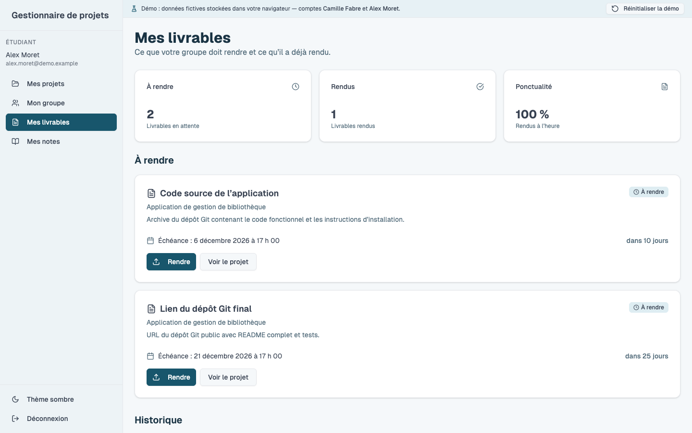
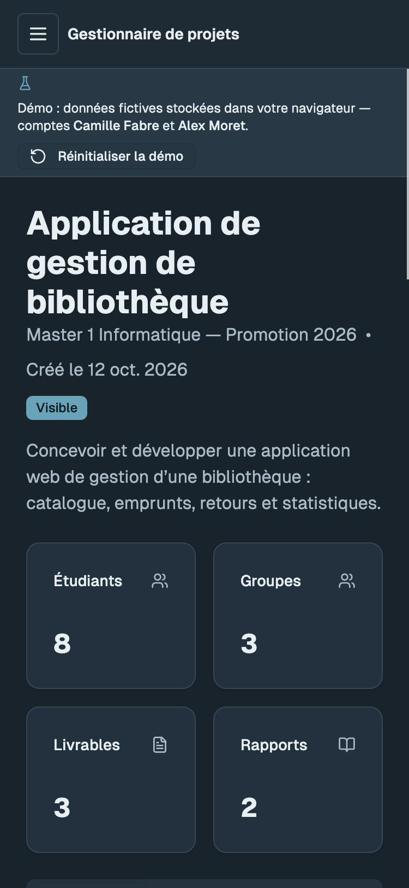

# Student Project Manager

Plateforme de suivi des projets étudiants, avec un espace enseignant et un espace étudiant. Elle couvre les promotions, les projets, les groupes, les livrables, les rapports, les soutenances et la notation.

**Démo en ligne, sans installation :** https://mazounirayan.github.io/student-project-manager/

L'écran de connexion propose deux comptes fictifs, sans mot de passe :

- **Camille Fabre**, enseignante : promotions, projets, groupes, livrables, notation, soutenances ;
- **Alex Moret**, étudiant du Groupe 1 : projets, groupe, rendus, rapport, notes.

Pour faire le tour :

1. Connectez-vous en étudiant et rendez le livrable « Code source de l'application ».
2. Reconnectez-vous en enseignante : le rendu apparaît dans l'onglet Livrables du projet, où vous pouvez le noter.
3. Une fois la note publiée, l'étudiant la retrouve dans « Mes notes ».

Les données sont stockées dans votre navigateur, et le bouton « Réinitialiser la démo » remet le jeu d'origine.






## Fonctionnalités

**Enseignant :**

- promotions et import d'étudiants (CSV ou JSON) ;
- projets en brouillon ou visibles, avec la taille des groupes ;
- constitution des groupes par glisser-déposer ;
- livrables avec échéance, pénalité de retard et règles de conformité vérifiées dans l'archive (fichiers requis, taille, dossiers) ;
- détection de similarité entre rendus ;
- grilles de notation pondérées et publication des notes ;
- planning des soutenances ;
- export des notes en CSV.

**Étudiant :**

- rejoindre un groupe ;
- rendre un livrable, avec vérification des règles avant l'envoi ;
- rédiger le rapport section par section ;
- consulter ses notes publiées, critère par critère.

L'interface est en français et propose un thème clair et sombre. Elle est utilisable sur mobile.

## Stack

| Partie | Technologies |
| --- | --- |
| `frontend/` | Next.js 14 (App Router), React 18, TypeScript, Tailwind CSS, Radix UI, dnd-kit, tiptap |
| `backend/` | Express 5, TypeORM, MySQL 8, JWT avec jetons de rafraîchissement, bcrypt |

## Démo statique

Construite avec `NEXT_PUBLIC_STATIC_DEMO=1`, l'interface intercepte les appels à `/api/...` et y répond à partir d'une base fictive stockée dans le `localStorage` (`frontend/lib/demo/`). Cette fausse API reprend les routes, les droits et les formats de réponse de l'API Express. Sans cette variable, l'interface appelle la vraie API.

```bash
npm --prefix frontend ci
npm --prefix frontend run build:demo   # export statique dans frontend/out
```

Le workflow `.github/workflows/pages.yml` publie la démo à chaque push sur `main`.

## Lancer en local avec l'API

Prérequis : Node.js 20 ou 22, npm et MySQL 8.

```bash
npm --prefix backend ci
npm --prefix frontend ci
```

Créer `backend/.env` :

| Variable | Rôle |
| --- | --- |
| `PORT` | port de l'API (4000 par défaut) |
| `DB_HOST`, `DB_PORT`, `DB_USER`, `DB_PASSWORD`, `DB_NAME` | connexion MySQL |
| `DB_SYNCHRONIZE` | `true` en développement pour créer le schéma (refusé en production) |
| `DB_LOGGING` | `true` pour afficher les requêtes SQL |
| `JWT_SECRET`, `JWT_REFRESH_SECRET` | deux secrets distincts d'au moins 32 caractères |
| `JWT_EXPIRES_IN`, `JWT_REFRESH_EXPIRES_IN` | durées des jetons, par exemple `1h` et `7d` |
| `FRONTEND_URL` | origine autorisée par CORS et liens des e-mails |
| `SMTP_HOST`, `SMTP_PORT`, `SMTP_USER`, `SMTP_PASS`, `FROM_EMAIL` | facultatif, envoi des e-mails |
| `GOOGLE_CLIENT_ID` | facultatif, connexion Google |

Côté interface, `NEXT_PUBLIC_BACKEND_URL` dans `frontend/.env.local` (par défaut `http://localhost:4000`).

Pour générer un secret :

```bash
node -e "console.log(require('crypto').randomBytes(48).toString('hex'))"
```

Créer la base MySQL :

```sql
CREATE DATABASE projectacademy CHARACTER SET utf8mb4 COLLATE utf8mb4_unicode_ci;
```

Pour créer le schéma, démarrer une première fois avec `DB_SYNCHRONIZE=true`, ou lancer `npm --prefix backend run schema:sync`. Démarrer ensuite les deux applications :

```bash
npm run dev:backend    # http://localhost:4000/api
npm run dev:frontend   # http://localhost:3000
```

L'inscription publique crée uniquement des comptes étudiants. Un compte enseignant se crée en ligne de commande :

```bash
npm --prefix backend run provision:teacher -- enseignant@example.com
```

## Vérifier

```bash
npm --prefix backend test              # build et tests de l'API, sans MySQL
npm --prefix frontend run typecheck
npm --prefix frontend run build
```

Les tests de l'API portent sur :

- les droits : un étudiant ne voit que son groupe et ses notes publiées, un enseignant uniquement ses projets ;
- les jetons et la validation des entrées ;
- les règles appliquées aux archives rendues et le calcul de similarité.

La CI (`.github/workflows/verify.yml`) lance ces vérifications à chaque push.

## Limites

Ce projet n'a pas été déployé en établissement :

- aucune migration versionnée n'est fournie ;
- la démo statique ne stocke pas les fichiers rendus (seuls le nom et la taille sont conservés) et ne génère pas les PDF ;
- les jetons de rafraîchissement ne sont pas révocables côté serveur.

## Licence

Apache-2.0. Voir [SECURITY.md](SECURITY.md) et [THIRD_PARTY_NOTICES.md](THIRD_PARTY_NOTICES.md).
