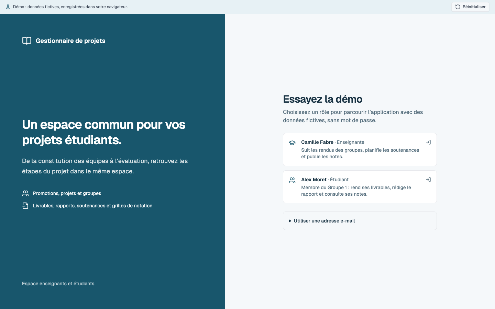
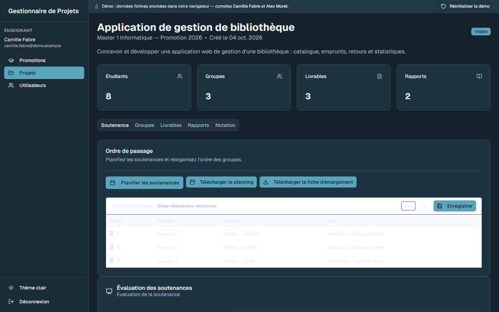

# Student Project Manager

Plateforme académique de gestion de projets étudiants : promotions, projets, groupes, livrables, rapports, soutenances et évaluations, avec deux espaces distincts — **enseignant** et **étudiant**.

> Interface : Next.js (App Router, React, TypeScript, Tailwind). API : Express, TypeORM, MySQL, JWT.
> ⚠️ Ce dépôt est un **prototype pédagogique**, pas un produit exploité en production. Aucune donnée réelle n'est utilisée : la démonstration en ligne repose sur des données fictives stockées dans votre navigateur.

**Démo en ligne (statique, sans backend) :**
👉 **https://mazounirayan.github.io/student-project-manager/**

| Écran de connexion | Détail projet (enseignant) | Mobile 375 px |
|---|---|---|
|  |  |  |

## Comptes de démonstration

La démo s'ouvre sur un écran de connexion avec deux boutons « un clic » — aucun mot de passe à saisir :

| Compte | Rôle | Ce que vous pouvez faire |
|---|---|---|
| **Camille Fabre** (`camille.fabre@demo.example`) | Enseignant | Parcourir la promotion et les projets, consulter les rendus des groupes (dont un en retard), planifier/réordonner les soutenances, noter les livrables, publier les notes, créer/supprimer des éléments. |
| **Alex Moret** (`alex.moret@demo.example`) | Étudiant | Voir ses projets et son groupe (Groupe 1), rendre le livrable « Code source de l'application », rédiger le rapport, consulter ses notes. |

Un bandeau discret « Démo : données fictives stockées dans votre navigateur » reste visible, avec un bouton **Réinitialiser la démo**.

Parcours conseillé : connectez-vous en étudiant, rendez le livrable en attente, puis reconnectez-vous en enseignant — la soumission apparaît dans l'onglet Livrables du projet, où vous pouvez la noter et publier les notes. De retour côté étudiant, la nouvelle note est visible dans « Mes notes ».

Autres captures : [notation (enseignant)](docs/enseignant-notation.png), [promotions](docs/enseignant-promotions.png), [livrables (étudiant)](docs/etudiant-livrables.png), [notes (étudiant)](docs/etudiant-notes.png), [connexion mobile](docs/mobile-connexion.png), [espace étudiant mobile](docs/mobile-etudiant.png).

## Fonctionnalités

- **Enseignant** : promotions (créer, modifier, supprimer, importer des étudiants via CSV), projets (brouillon/visible, tailles de groupes, date limite), constitution des groupes par glisser-déposer, livrables (archive ou lien Git, échéances, pénalités, règles de validation), notation par grilles et critères, pondérations, publication des notes, soutenances (planification, ordre de passage, export PDF côté backend).
- **Étudiant** : projets de sa promotion, rejoindre un groupe (mode libre), espace de groupe (rendre ses livrables, suivre les règles de conformité, rédiger le rapport), notes détaillées par critère.
- **Thème clair/sombre** (suit `prefers-color-scheme` par défaut, mémorisé), interface entièrement en français, écrans de chargement, états vides et confirmations avant chaque suppression.

## Stack

| Couche | Technologies |
|---|---|
| Frontend | Next.js 14 (App Router), React 18, TypeScript, Tailwind CSS 4, Radix UI, dnd-kit, tiptap, sonner |
| Backend | Node.js, Express 5, TypeORM, MySQL 8, JWT + refresh tokens, bcrypt, Swagger |
| Qualité | `tsc --noEmit` (frontend), build TypeScript (backend), 5 tests natifs Node (backend) |
| CI / déploiement | `.github/workflows/verify.yml` (typecheck + builds + tests au push sur main), `.github/workflows/pages.yml` (build et déploiement de la démo via Actions). La démo en ligne est déployée en mode « deploy from a branch » sur la branche `gh-pages` (gratuit, sans Actions) : voir ci-dessous. |

## Mode démo statique (GitHub Pages)

Le frontend embarque un **mode démo activé à la construction** (`NEXT_PUBLIC_STATIC_DEMO=1`, voir `frontend/scripts/build-demo.mjs`) :

- un intercepteur `fetch` répond à toutes les routes `/api/...` à partir d'une **base fictive conservée dans le localStorage** (données réalistes : une promotion, deux projets, trois groupes, livrables rendus/retard/à rendre, soutenances planifiées, notes) ;
- les actions sont persistées dans le navigateur et partagées entre les deux comptes de démo ;
- hors de ce mode (installation locale classique), **aucun comportement ne change** : l'application interroge l'API Express réelle.

```powershell
# Générer la démo statique dans frontend/out
npm --prefix frontend run build:demo
```

**Mise à jour de la démo en ligne** (branche `gh-pages`, mode « deploy from a branch », gratuit) :

```powershell
npm --prefix frontend run build:demo
git switch --orphan gh-pages
Copy-Item "frontend\out\*" -Destination . -Recurse -Force
New-Item -ItemType File -Name .nojekyll -Force | Out-Null
git add .nojekyll 404.html 404 _next auth deliverables favicon.svg grading index.html index.txt my-deliverables my-grades my-group my-projects projects promotions users
git commit -m "Mise a jour de la demo statique"
git push origin gh-pages --force
git switch main
```

> Ne jamais ajouter les dossiers `backend/`, `frontend/` ni de fichier `.env*` à la branche `gh-pages` : elle ne contient que l'export statique.

## Installation locale (mode réel, avec MySQL)

Prérequis : Node.js 20 ou 22, npm, MySQL 8.

```powershell
npm --prefix backend install
npm --prefix frontend install
```

1. Créez `backend/.env` avec vos valeurs locales :

```ini
# Serveur
PORT=4000
NODE_ENV=development

# Base MySQL
DB_HOST=localhost
DB_PORT=3306
DB_USER=student_projects
DB_PASSWORD=votre_mot_de_passe_local
DB_NAME=projectacademy
DB_SYNCHRONIZE=true        # création du schéma en développement uniquement
DB_LOGGING=false

# Secrets JWT (deux valeurs distinctes, 32 caractères minimum — requis au démarrage)
JWT_SECRET=<chaîne aléatoire>
JWT_REFRESH_SECRET=<autre chaîne aléatoire>
JWT_EXPIRES_IN=1h
JWT_REFRESH_EXPIRES_IN=7d

# Interface (CORS et liens dans les e-mails)
FRONTEND_URL=http://localhost:3000

# Optionnel : SMTP (invitations, réinitialisations) et OAuth Google
# SMTP_HOST=localhost
# SMTP_PORT=587
# SMTP_USER=
# SMTP_PASS=
# FROM_EMAIL=noreply@exemple.fr
# GOOGLE_CLIENT_ID=
```

2. Créez `frontend/.env.local` si nécessaire :

```ini
# URL de l'API (4000 par défaut)
NEXT_PUBLIC_BACKEND_URL=http://localhost:4000
```

> ⚠️ Ne publiez jamais vos fichiers `.env` : ils sont ignorés par Git.

3. Générez les deux secrets JWT (à insérer dans `backend/.env`) :

```powershell
node -e "console.log(require('crypto').randomBytes(48).toString('hex'))"
```

4. Créez la base MySQL vide :

```sql
CREATE DATABASE projectacademy CHARACTER SET utf8mb4 COLLATE utf8mb4_unicode_ci;
CREATE USER 'student_projects'@'localhost' IDENTIFIED BY 'votre_mot_de_passe_local';
GRANT ALL PRIVILEGES ON projectacademy.* TO 'student_projects'@'localhost';
```

5. Démarrez les deux serveurs (deux terminaux) :

```powershell
npm run dev:backend    # API sur http://localhost:4000/api
npm run dev:frontend   # Interface sur http://localhost:3000
```

Documentation Swagger : `http://localhost:4000/api-docs`. Santé : `http://localhost:4000/health`.

**Comptes** : l'inscription publique (`POST /api/auth/register`) et OAuth créent uniquement des étudiants. Un enseignant se provisionne localement :

```powershell
npm --prefix backend run provision:teacher -- enseignant@example.com
```

Il n'y a pas de jeu de seed : créez une promotion, ajoutez des étudiants, puis un projet depuis l'interface.

## Vérifications

```powershell
npm run build:backend
npm --prefix backend test
npm --prefix frontend run typecheck
npm run build:frontend
```

## Limites connues (honnêtes)

- **Prototype, pas un produit** : aucune utilisation réelle en établissement, aucune métrique d'usage ou de performance revendiquée.
- **Démo statique simplifiée** : les fichiers téléversés ne sont pas réellement stockés (seuls le nom et la taille sont conservés) ; les exports PDF/planning et le téléchargement des rendus sont désactivés ; l'analyse de similarité est simulée. Ces limites sont affichées dans l'interface.
- **Backend partiellement câblé** : en mode réel, plusieurs écrans du frontend appellent des routes que l'API n'expose pas encore (panneaux de notation `sessions`/`my-grades`/`summary`, configuration des rapports, validation de livrable avant soumission) — ces fonctionnalités ne fonctionnent pour l'instant que dans la démo statique ou renvoient une erreur côté réel. Les routes CRUD essentielles (auth, promotions, projets, groupes, livrables, soumissions, soutenances, grilles) sont câblées.
- **Migrations absentes** : le schéma est créé par `DB_SYNCHRONIZE=true` en développement uniquement ; aucun jeu de migrations versionné n'est fourni.
- **E-mails non configurés** : aucun SMTP de test n'est fourni ; invitations, réinitialisations de mot de passe et rappels d'échéance ne partent pas.
- **Sécurité à durcir avant un usage réel** : contrôle de propriété par ressource à généraliser, pagination et rate-limiting à affiner, audit de dépendances à faire (voir `SECURITY.md`).
- **Windows** : le build frontend peut nécessiter une exécution avec droits élargis (erreur EPERM sur `.next/`).

## Organisation du code

- `frontend/app` : pages Next.js ; `frontend/components` : formulaires, dialogues et écrans métier ; `frontend/lib/demo` : intercepteur et base fictive de la démo ; `frontend/services` + `frontend/lib/api.ts` : couche HTTP partagée.
- `backend/src/server.ts` : point d'entrée ; `backend/src/routes` + `controllers` + `services` : API REST ; `backend/src/entities/Entities.ts` : modèle TypeORM.
- `backend/uploads` (ignité) contient les dépôts réels : ne jamais publier ce dossier.

## Licence et contributions

Apache 2.0 — voir [LICENSE](LICENSE) et [THIRD_PARTY_NOTICES.md](THIRD_PARTY_NOTICES.md). Les règles de contribution sont dans [CONTRIBUTING.md](CONTRIBUTING.md), les signalements de sécurité dans [SECURITY.md](SECURITY.md).
